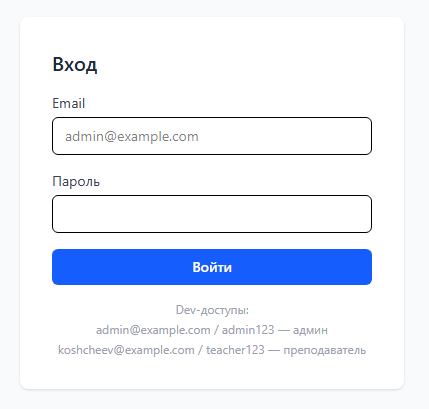
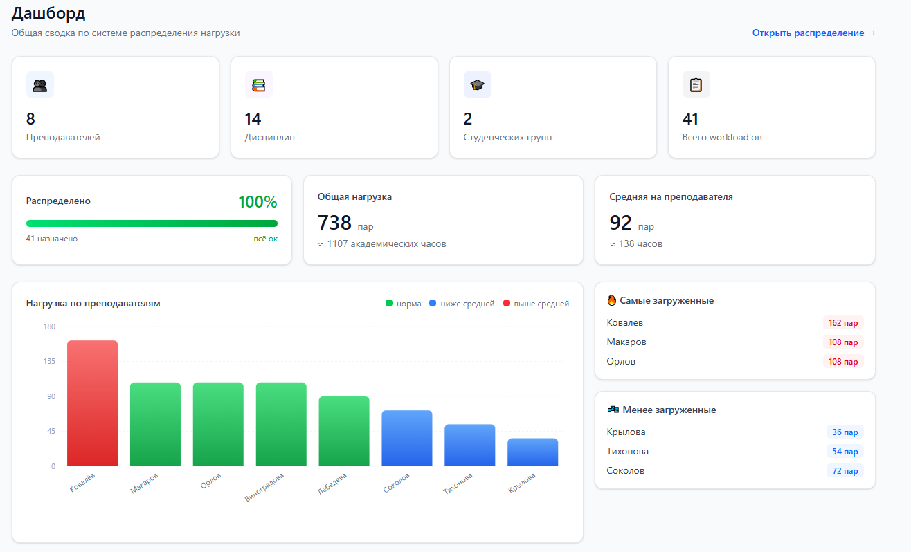
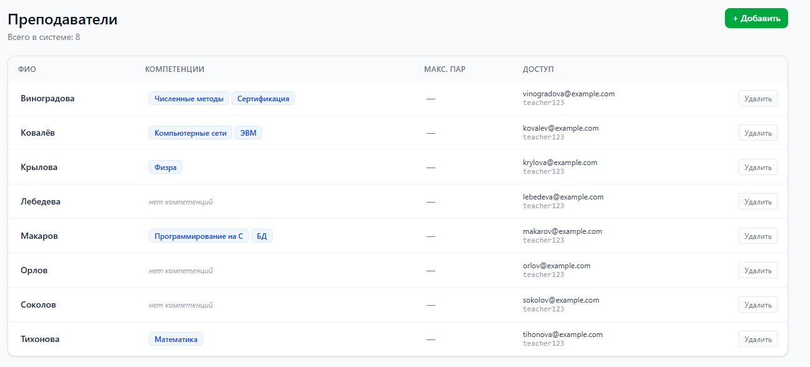
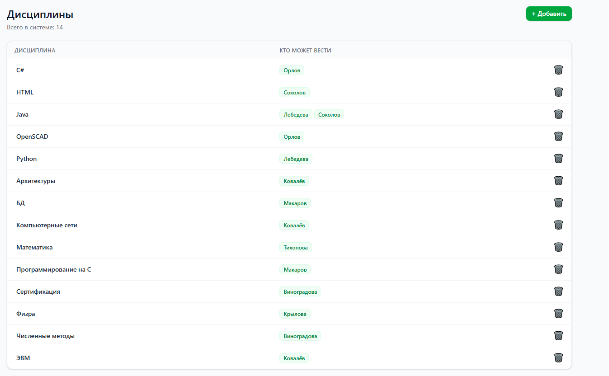
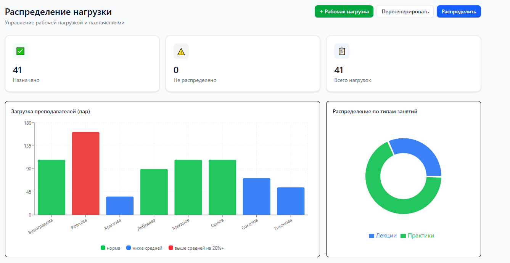
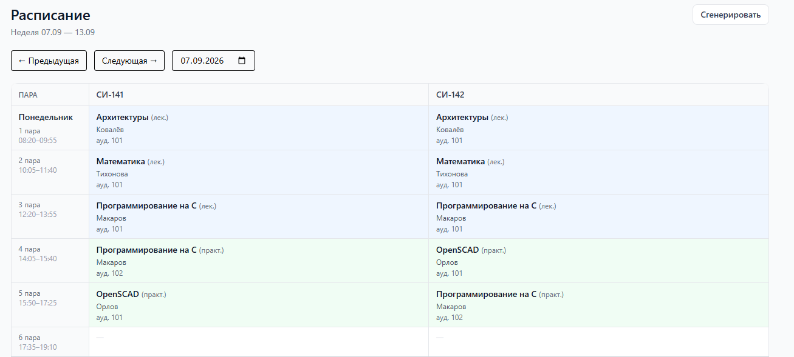
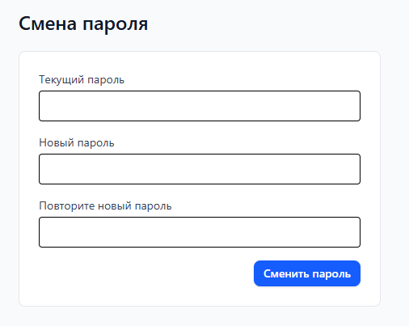
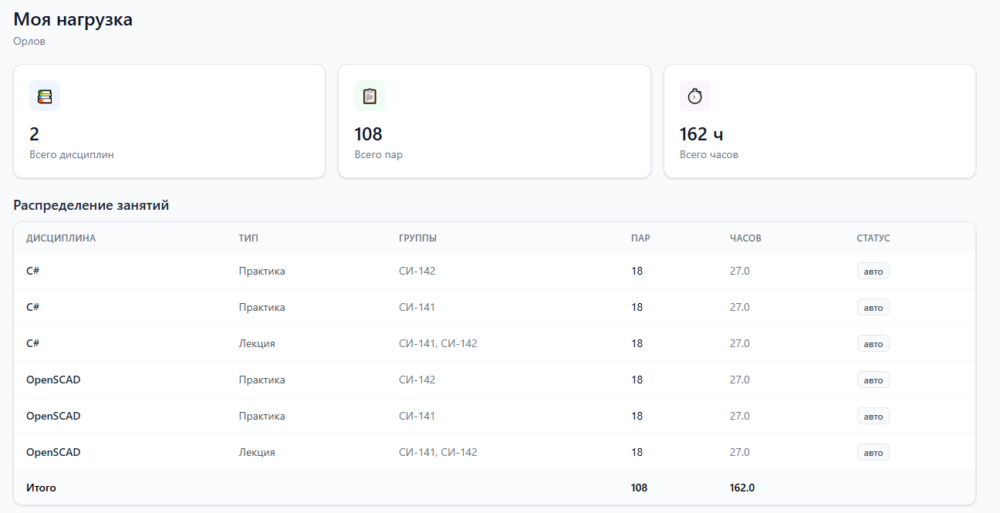
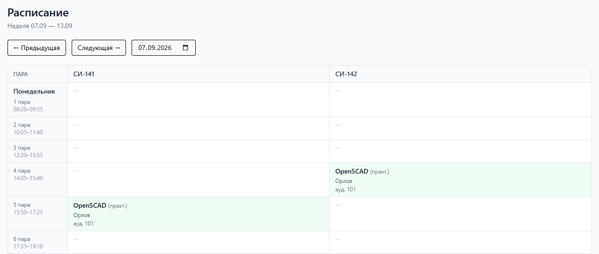

# Система распределения нагрузки преподавателей

Информационная система для автоматизированного распределения учебной
нагрузки между преподавателями учебного заведения.

## О проекте

Система решает задачу, с которой сталкивается каждый учебный отдел:
**как распределить нагрузку между преподавателями так, чтобы каждый вёл
только то, что умеет, и при этом нагрузка была равномерной?**

Приложение автоматизирует этот процесс:

- **Справочники** — преподаватели, дисциплины, группы, аудитории
- **Компетенции** — какой преподаватель что может вести
- **Автоматическое распределение** — с учётом компетенций и лимитов
- **Ручные правки** — если администратор хочет скорректировать
- **Генерация расписания** — расстановка пар по семестру с проверкой конфликтов
- **Учётные данные преподавателей** — система сама генерирует email и пароль
- **Роли** — администратор и преподаватель видят разное
- **Визуализация** — графики нагрузки, покрытия дисциплин

## Возможности

### Для администратора учебного отдела

- Управление справочниками: преподаватели, дисциплины, группы, аудитории
- Назначение компетенций
- Редактирование нагрузок (количество пар, тип, группы)
- Запуск алгоритма распределения
- Ручная корректировка назначений
- Просмотр метрик: загрузка преподавателей, покрытие дисциплин
- Сброс ручных правок и перераспределение
- Генерация расписания на весь семестр
- Редактирование отдельных пар (дата, номер, аудитория)
- Просмотр расписания по неделям
- **Просмотр учётных данных преподавателей** (email + текущий пароль)
- Смена собственного пароля

### Для преподавателя

- Просмотр своей учебной нагрузки
- Список дисциплин, типов занятий, групп
- Итоговые пары и часы
- Просмотр своего расписания
- **Смена своего пароля**

## Технологический стек

| Слой | Технологии |
|------|-----------|
| **Frontend** | React 18, TypeScript, Vite, Tailwind CSS, TanStack Query, Zustand, Axios, React Hook Form, Recharts, Zod, React Router |
| **Backend** | Node.js, Fastify, TypeScript, mysql2, JWT, argon2, nanoid |
| **БД** | MySQL 8.0 |
| **Тесты** | Vitest (unit-тесты на алгоритмы) |
| **Деплой** | Docker, Docker Compose, Nginx |
| **Инструменты** | Bruno (REST-клиент), MySQL Workbench, ESLint |

**Frontend** — SPA на React, общается с бэком через REST API.
JWT-токен кладётся в `Authorization: Bearer ...` через axios-интерцептор.

**Backend** — REST API на Fastify, работает с MySQL через пул соединений
`mysql2`. Содержит бизнес-логику: два алгоритма (распределение нагрузки и
генерация расписания), валидацию, аутентификацию, генерацию учётных данных
преподавателей.

**БД** — MySQL 8 с 10 таблицами, связями M:N, каскадными удалениями,
транзакциями.

## Быстрый старт

### Вариант A — Docker

**Требования:** только [Docker Desktop](https://www.docker.com/products/docker-desktop/)

```bash
git clone <url>
cd teacher-load
docker compose up -d
```

Через 30–60 секунд откройте **http://localhost:8080**.

**Учётные записи по умолчанию:**

| Роль | Email | Пароль | ФИО |
|------|-------|--------|-----|
| Администратор | admin@example.com | admin123 | — |
| Преподаватель | kovalev@example.com | teacher123 | Ковалёв |
| Преподаватель | makarov@example.com | teacher123 | Макаров |
| Преподаватель | lebedeva@example.com | teacher123 | Лебедева |
| Преподаватель | orlov@example.com | teacher123 | Орлов |
| Преподаватель | sokolov@example.com | teacher123 | Соколов |
| Преподаватель | vinogradova@example.com | teacher123 | Виноградова |
| Преподаватель | tihonova@example.com | teacher123 | Тихонова |
| Преподаватель | krylova@example.com | teacher123 | Крылова |

**Полезные команды:**

```bash
docker compose ps           # статус контейнеров
docker compose logs -f      # логи в реальном времени
docker compose down         # остановить (данные сохранятся)
docker compose down -v      # остановить и удалить данные
docker compose restart      # перезапустить
```

### Вариант B — Локальная разработка

**Требования:** Node.js 18+, MySQL 8.0+

**1. Клонирование:**

```bash
git clone <url>
cd teacher-load
```

**2. База данных:**

Откройте MySQL Workbench или командную строку MySQL:

```sql
CREATE DATABASE teacher_load
  CHARACTER SET utf8mb4
  COLLATE utf8mb4_unicode_ci;

USE teacher_load;
```

Затем примените скрипты из `backend/docker/mysql-init/`:

```bash
mysql -u root -p teacher_load < backend/docker/mysql-init/01-schema.sql
mysql -u root -p teacher_load < backend/docker/mysql-init/02-seed.sql
```

**3. Backend:**

```bash
cd backend
npm install
```

Создайте файл `.env` (скопируйте из `.env.example` или создайте вручную):

```env
PORT=3000
DB_HOST=localhost
DB_PORT=3306
DB_USER=root
DB_PASSWORD=ваш_пароль
DB_NAME=teacher_load
JWT_SECRET=сгенерируйте-длинную-случайную-строку
```

**Про JWT_SECRET** — сгенерировать можно так:

```bash
node -e "console.log(require('crypto').randomBytes(64).toString('hex'))"
```

Затем:

```bash
npm run seed    # создаст пользователей, справочники
npm run dev     # запустит на http://localhost:3000
```

**4. Frontend:**

В отдельном терминале:

```bash
cd frontend
npm install
npm run dev     # запустит на http://localhost:5173
```

**5. Вход:**

Откройте http://localhost:5173, войдите:

- **Администратор:** `admin@example.com` / `admin123`
- **Преподаватель:** `kovalev@example.com` / `teacher123`

## Порядок работы с системой

1. **Преподаватели** (`/teachers`):
   - Добавьте преподавателей. Система сама сгенерирует email и пароль.
   - Назначьте компетенции (клик по колонке «Компетенции»).

2. **Дисциплины** (`/disciplines`):
   - Проверьте список дисциплин.

3. **Распределение нагрузки** (`/allocation`):
   - «Перегенерировать» — создаёт нагрузки из дисциплин и групп.
   - «Распределить» — распределяет между преподавателями.
   - Ручные правки — по клику.

4. **Расписание** (`/schedule`):
   - «Сгенерировать» — создаёт расписание на семестр.
   - Клик по паре — редактировать.
   - Клик по пустой клетке — создать.

5. **Смена пароля** (`/change-password`):
   - Доступна и админу, и преподавателю.
   - При смене пароля преподом админ видит новый пароль в `/teachers`.

**Важно:** сначала распределите нагрузку, потом генерируйте расписание.

## Структура проекта

```
teacher-load/
├── docker-compose.yml      ← Docker-оркестрация
├── README.md               ← этот файл
│
├── frontend/               React-приложение
│   ├── Dockerfile          Сборка + Nginx
│   ├── nginx.conf          Конфиг Nginx (SPA + proxy)
│   └── src/
│       ├── app/            Инициализация, роутер, layout
│       ├── pages/          Страницы
│       ├── features/       Бизнес-логика по доменам
│       ├── shared/         Общие компоненты, api, types
│       └── stores/         Zustand-сторы
│
├── backend/                Fastify API
│   ├── Dockerfile          Многоступенчатая сборка
│   ├── docker/
│   │   └── mysql-init/     SQL-скрипты (01-schema.sql, 02-seed.sql)
│   └── src/
│       ├── auth/           JWT, argon2, guard
│       ├── routes/         REST-эндпоинты (teachers, schedule, allocation, ...)
│       ├── utils/          transliterate, generatePassword
│       ├── db.ts           Пул соединений MySQL
│       └── server.ts       Точка входа
│
└── docs/                   Документация
    ├── database.md         Обоснование схемы БД
    ├── er-diagram.md       ER-диаграмма (Mermaid)
    ├── sql-examples.md     Примеры SQL-запросов
    ├── algorithm.md        Описание алгоритмов
    └── api.md              Справочник API
```

## Скриншоты

### Авторизация


### Дашборд


### Преподаватели


### Дисциплины


### Распределение нагрузки


### Расписание


### Смена пароля


### Моя нагрузка (для преподавателя)


### Расписание (для преподавателя)


## Тесты

Алгоритмы покрыты unit-тестами:

```bash
cd backend
npm run test:run
```

**Ожидаемый вывод:**

```
 ✓ src/routes/allocation.test.ts        (n tests)
 ✓ src/routes/schedule.test.ts          (n tests)
 ✓ src/utils/transliterate.test.ts      (n tests)
 ✓ src/utils/generatePassword.test.ts   (n tests)

 Test Files  n passed (n)
      Tests  n passed (n)
```

## Документация

Полная документация — в папке [`docs/`](./docs/):

- **[Обоснование схемы БД](./docs/database.md)** — почему MySQL, нормализация, типы, индексы
- **[ER-диаграмма](./docs/er-diagram.md)** — все сущности и связи
- **[SQL-примеры](./docs/sql-examples.md)** — примеры запросов с объяснениями
- **[Алгоритмы](./docs/algorithm.md)** — распределение нагрузки и генерация расписания
- **[REST API](./docs/api.md)** — все эндпоинты

## Безопасность

- **Пароли** хэшируются через `argon2id` (современный стандарт)
- **JWT** живёт 7 дней, секрет хранится в `.env` (или в `docker-compose.yml`)
- **Роли** проверяются на бэке (не только на фронте)
- **SQL** — только параметризованные запросы (защита от инъекций)
- **CORS** ограничен доверенным origin
- **Docker** — изолированные контейнеры, БД не доступна извне (только `:3307` для отладки)

**Про `initial_password`.** Для удобства администратора пароль преподавателя дублируется в открытом виде в поле `initial_password`. Это учебный компромисс: в продакшне так делать нельзя, вместо этого используют функцию сброса пароля через email или одноразовые ссылки. При смене пароля преподом `initial_password` обновляется на новый пароль, так что админ всегда видит актуальный.

## Развёртывание на другом ПК (без интернета)

Если нужно развернуть на машине без доступа к интернету:

**1. На своём ПК собрать образы и сохранить их в файл:**

```bash
docker compose build
docker save teacher-load-backend teacher-load-frontend mysql:8.0 -o images.tar
```

**2. Скопировать на флешку:**

```
flash/
├── images.tar
├── docker-compose.yml
├── backend/docker/mysql-init/   (SQL-скрипты)
└── START.bat
```

**3. На целевом ПК (с установленным Docker Desktop):**

```bash
docker load -i images.tar
docker compose up -d
```

Открыть **http://localhost:8080**.

## Контекст

Проект выполнен как **курсовая работа** по дисциплине, связанной с
проектированием баз данных, в 2026 году.

**Тема:** «Разработка информационной системы автоматизированного
распределения нагрузки преподавателей учебного заведения».

## Лицензия

Учебный проект. Свободное использование в образовательных целях.

## Автор

*Воробьев Савелий Игоревич* — студент *СИ142* группы